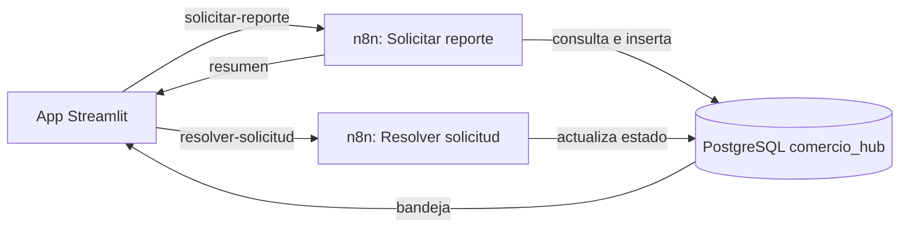
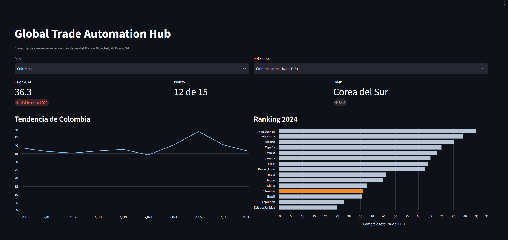
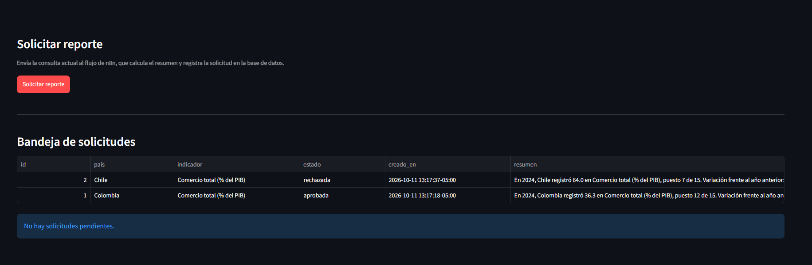
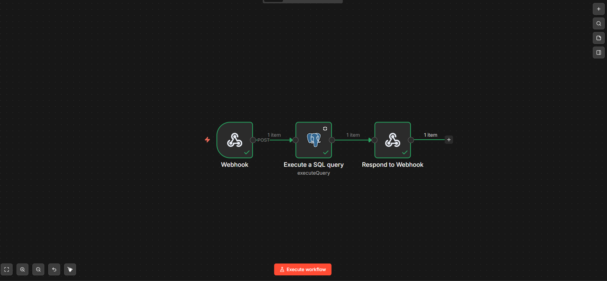
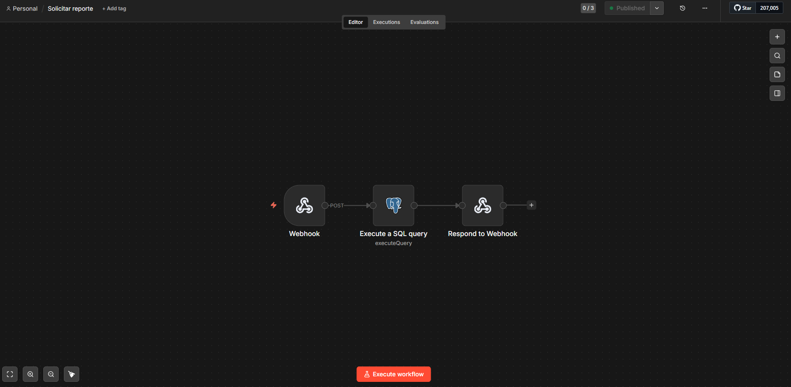

# Global Trade Automation Hub

App de consulta y flujo de aprobación de reportes de comercio exterior, construidos con datos abiertos del Banco Mundial: 15 países, 2015 a 2024 y 4 indicadores (exportaciones, importaciones y comercio total como porcentaje del PIB, y PIB per cápita).

El analista consulta un país e indicador, solicita un reporte, y un flujo automatizado calcula el resumen, registra la solicitud y permite aprobarla o rechazarla desde una bandeja.

## Cómo funciona



## Capturas






## Stack

- PostgreSQL 18: datos y solicitudes
- Streamlit: app de consulta y bandeja
- n8n: flujos de automatización (webhooks)
- Python: pandas, psycopg2, requests

## Hallazgo de ejemplo

En 2024 Colombia ocupa el puesto 12 de 15 en comercio total como porcentaje del PIB (36,3), con una variación de -3,8 frente a 2023. Corea del Sur lidera con 84,6.

## Cómo ejecutarlo

1. Crear la base `comercio_hub` en PostgreSQL con las tablas `datos_comercio` y `solicitudes` y cargar `data_raw/world_bank_trade_clean.csv` (600 filas).
2. Copiar `.env.example` a `.env` y completar los datos de conexión.
3. En n8n: crear la credencial de PostgreSQL, importar los dos archivos de `flows/` y publicarlos.
4. Instalar dependencias y ejecutar la app:

```bash
pip install -r requirements.txt
streamlit run app/app.py
```

Las tablas:

```sql
CREATE TABLE datos_comercio (
  country_name text, country_code text, series_name text,
  series_code text, value numeric, year integer, indicator text
);

CREATE TABLE solicitudes (
  id serial PRIMARY KEY,
  pais text NOT NULL,
  indicador text NOT NULL,
  estado text NOT NULL DEFAULT 'pendiente',
  resumen text,
  creado_en timestamptz NOT NULL DEFAULT now()
);
```

## Decisiones y limitaciones

- **Por qué n8n y Streamlit y no Power Apps y Power Automate:** las herramientas de Microsoft exigen una cuenta de trabajo o de estudio, y este proyecto se construyó con una cuenta personal. Se eligió un stack equivalente de código abierto.
- **Los datos son históricos.** La app no consulta información en tiempo real: el flujo trabaja sobre el conjunto cargado.
- **Entorno local.** Se usó el usuario administrador de PostgreSQL para simplificar. En un entorno real se crearía un usuario con permisos limitados.
- **Variación:** el valor mezcla unidades entre indicadores, por eso nunca se agrega entre ellos; cada consulta usa un solo indicador.

## Estructura

- `app/`: aplicación Streamlit
- `flows/`: flujos de n8n exportados
- `data_raw/`: datos del Banco Mundial
- `docs/`: capturas
